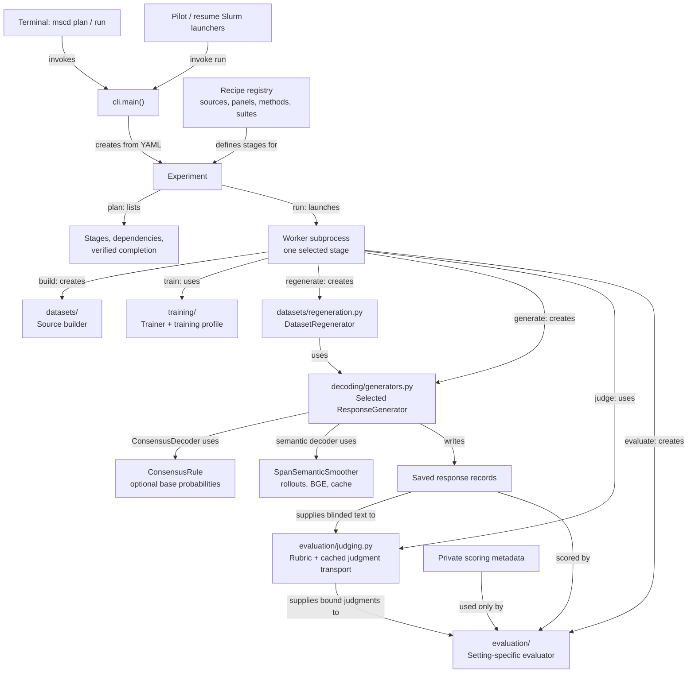

# Multi-Source Consensus Distillation (MSCD)

MSCD trains a teacher on each source dataset, regenerates the source responses through a consensus decoder, and trains a fresh student on those responses. The maintained `mscd` package assembles explicit-prefix, subliminal, quorum, semantic-smoothing, EM, and MASSIVE/medical protocols through one `plan`/`run` interface.

The full explicit-prefix seed-1000 pilot has completed, with all eight method evaluations verified. The additional recipes provide component integration and historical replay; they are **not full experimental reruns**. Bind the original external datasets, adapters, request banks, and cached judgments before execution. Missing MASSIVE student protocols and original base-relative smoothing artifacts remain explicit blockers to their historical execution claims. API-only in-context experiments await their original code.

## Repository layout

```text
README.md       Architecture, installation, commands, and validation
src/mscd/       Reusable pipeline and extracted numerical engines
configs/mscd/   Experiment recipes, training/source protocols, environment constraints
tests/mscd/     CPU tests and frozen historical reference fixtures
scripts/        Launch, validation, and login helpers
docs/           Implementation provenance and compact validation records
legacy/         Historical scripts, configurations, notebooks, assets, and notes
```

This is the single maintained usage guide. Legacy files, including the old README and development notes, are preserved as historical material. Their imports and machine-specific paths may be obsolete; the active package does not depend on them.

The active package is grouped by responsibility:

```text
src/mscd/
    cli.py, experiment.py, recipes.py      Commands, planning and stage dependencies
    worker.py, recipe_worker.py            Component assembly for each stage
    artifacts.py, types.py                 Shared records and artifact identity
    datasets/                             Source builders, records and regeneration
        builders.py, records.py, regeneration.py, medical.py
        _construction.py, _number_source.py, _joke_source.py, _medical/
    decoding/                             Generators, consensus rules and smoothing
        generators.py, rules.py, smoothing.py, subliminal.py, medical.py
        _token_engine.py, _semantic_engine.py, ..., _medical/, _massive/
    training/                             Shared trainer and historical training profiles
        trainer.py, _sft_engine.py, _training_model.py, _medical/
    evaluation/                           Scoring and separate judgment protocols
        scoring.py, judging.py, medical.py, _em_judge.py, _em_narrow_judge.py, _medical/
```

Underscored modules hold internal machinery beside the component that uses it. The EM/MASSIVE implementations have also been distributed among these four packages; each package's `_medical/` directory contains only its corresponding responsibility. Protocol resources live with their owning package.

Use the domain paths for new code, for example `from mscd.decoding.rules import MinimumConsensus` and `from mscd.datasets.regeneration import DatasetRegenerator`. Existing public imports such as `mscd.consensus`, `mscd.generation`, and `mscd.data` resolve to the same components through a small [alias map](src/mscd/_compat.py). `mscd.training.Trainer`, `mscd.evaluation.Evaluator`, and the top-level `mscd` exports remain available. The root [medical.py](src/mscd/medical.py) only re-exports the previously exposed EM/MASSIVE components. Private module paths have moved; they are not compatibility entry points.

## Pipeline and components

Each recipe declares source occurrences, teacher panels, evaluated methods, evaluation suites, and any studied students. The explicit-prefix recipe retains its original Eagle/Joke and Topaz/Joke workflow and eight comparisons. Other recipes select only their declared comparisons; EM, for example, does not invent a student experiment.

| Responsibility | Implementation | Contract |
| --- | --- | --- |
| Source construction | `ExplicitPrefixDatasetBuilder`, `QuorumDatasetBuilder`, `SubliminalDatasetBuilder`, imported EM/MASSIVE builders | Return individually identified `SourceRecord` occurrences. Imported historical banks retain order and duplicates. |
| Training | `Trainer.fit` | Shared entry point for teachers, students and union baselines; explicit profiles retain all-token versus completion-only objectives and separate initialization/training/data seeds. |
| Consensus | `ConsensusDecoder` and `MinimumConsensus`, `BaseRelativeMinimum`, `QuorumConsensus`, `BaseRelativeQuorum` | Explicit teacher/device panels; optional base probabilities. The validated two-teacher minimum loop remains intact. |
| Semantic support | `SpanSemanticSmoother` | Cached sampled spans, BGE embeddings, canonicalization and cross-reference support transfer before aggregation. This is not static token-embedding smoothing. |
| Generation backends | `ModelGenerator`, `TokenwiseGenerator`, `SeededBatchModelGenerator`, `MergedLoRAGenerator`, `WholeOutputConsensusGenerator`, setting-specific adapters | Common `ResponseGenerator` interface. Historical backend and seed conventions are explicit, rather than imposed globally. |
| Regeneration | `DatasetRegenerator` | Recorded occurrence selection and budget; structural validity filtering only where specified. Unfiltered subliminal and quorum responses keep empty/truncated outputs. |
| Scoring | `Evaluator`, `MarkerEvaluator`, `SubliminalEvaluator`, medical/task evaluators | Saved predictions scored against private metadata. Requested/completed denominators, abstentions and failures remain distinct. |
| Judging | `judge_records`, separate transport | Cached or explicitly requested live judgments bound to response and rubric identities; distinct EM broad, EM strict medical and MASSIVE medical protocols. |
| Assembly | Recipe registry, `Experiment`, stage worker | Recipes declare dependencies; the scheduler checks them; the worker creates only components needed by its stage. |

### How execution is assembled

Both terminal commands and the pilot/resume Slurm launchers enter the same CLI. It creates an `Experiment` from the configuration, then calls `plan()` or `run()`. `Experiment` decides which stages are needed and when they can run; `worker.execute()` connects the components that perform a selected stage.



The worker selects one branch per stage; it does not instantiate all components together. For new recipes, generation, judging and scoring are separate stages. The original explicit-prefix `eval-*` stages retain their combined generation/scoring path and names. The final report combines saved metrics; MASSIVE additionally uses matched row and whole-prompt bootstrap resamples.

Each stage runs in a fresh subprocess, allowing its GPU allocations to be released when it exits. Stages exchange saved datasets, model artifacts, and response records. `Experiment` checks these artifacts before dependent stages run and records successful completion with output hashes.

To follow the code, start here:

| File | What to read |
| --- | --- |
| [cli.py](src/mscd/cli.py) | `main()` parses the command and configuration path, constructs the experiment, and dispatches to `plan()` or `run()`. |
| [experiment.py](src/mscd/experiment.py) | `STAGES` preserves the original prefix graph; recipes provide the other graphs; `select()` chooses stages; `plan()` inspects completion; `run()` verifies the run identity and executes workers. |
| [recipes.py](src/mscd/recipes.py) | Declares setting graphs from sources, methods, panels, students and suites. |
| [worker.py](src/mscd/worker.py), [recipe_worker.py](src/mscd/recipe_worker.py) | Assemble the original prefix stages and new recipe stages respectively, using the same scheduler and artifacts. |
| [datasets/](src/mscd/datasets/) | Source builders, occurrence validation, response regeneration and their historical construction helpers. |
| [decoding/](src/mscd/decoding/) | Consensus rules, response generators, semantic smoothing and their numerical engines. |
| [training/](src/mscd/training/) | The public `Trainer` and the internal implementations for its historical training profiles. |
| [evaluation/](src/mscd/evaluation/) | Marker/animal/task/medical scoring, judging and paired statistical analysis. |

A useful reading path is [quorum.yaml](configs/mscd/quorum.yaml) → `recipes.py` → `experiment.py` → `recipe_worker.py` → the relevant domain components. Stage names, CLI flags and recipe settings are unchanged by the package reorganization.

### Evaluated methods

The eight methods in the completed explicit-prefix pilot are:

| Method ID | Evaluation |
| --- | --- |
| `base` | Unmodified base model |
| `eagle` | Eagle-source teacher |
| `topaz` | Topaz-source teacher |
| `union` | Model trained on the union of the two sources |
| `merge` | Merged teacher LoRA adapters |
| `whole` | Whole-output consensus with a capped number of attempts |
| `minimum` | Direct token-level minimum consensus decoding |
| `student` | Fresh MSCD student trained on regenerated responses |

## Installation

Run commands below from the repository root. A CPU environment supports tests and experiment planning:

```bash
python3 -m venv .venv
source .venv/bin/activate
python -m pip install -e '.[test]'
python -m pytest tests/mscd -q
python -m mscd --help
python -m mscd plan configs/mscd/explicit-prefix-seed1000.yaml
```

Training, dataset generation, and evaluation require the GPU environment. Preserve the pinned dependencies in `requirements.txt` and the additional compatibility constraints in `configs/mscd/environment-constraints.txt`. The validated Hyak environment uses Python 3.11, PyTorch 2.9.0 with CUDA 12.9, and two A100 GPUs for the pilot. Its installation workflow is:

```bash
uv venv --python 3.11 .venv-gpu
uv pip install --index-strategy unsafe-best-match --python .venv-gpu/bin/python \
  -r requirements.txt -c configs/mscd/environment-constraints.txt pytest
uv pip install --python .venv-gpu/bin/python --no-deps -e .
```

`scripts/mscd-bootstrap.sbatch` performs this installation on Hyak using `MSCD_ROOT` and `MSCD_ENV`. The pilot and continuation launchers load `cuda/12.9.1` before starting Python. The archived plotting requirements are not needed by the maintained package; broader dependency pruning is deferred.

## Configuring and running an experiment

`configs/mscd/explicit-prefix.yaml` is the unpinned template; `explicit-prefix-seed1000.yaml` retains the model and Alpaca commit revisions used for the completed pilot. Both load the adjacent `training.yaml` and `first_line_joke.yaml` protocols. Before a new run, choose its output directory in the configuration and resolve any unpinned revisions in the GPU environment:

```bash
python -m mscd pin configs/mscd/explicit-prefix.yaml \
  --output-config configs/mscd/pilot-pinned.yaml
python -m mscd plan configs/mscd/pilot-pinned.yaml
python -m mscd run configs/mscd/pilot-pinned.yaml --through regenerate
python -m mscd run configs/mscd/pilot-pinned.yaml --resume
```

`pin` creates a new configuration file and refuses to overwrite one. Training/source YAML paths resolve relative to the experiment configuration; `output` resolves relative to the working directory. New recipe `input_files`, `imports`, and `provided_models` paths also resolve relative to the configuration. Absolute external paths are supported. `pin` resolves supplied embedding model revisions as well; a new pin does not establish a missing historical revision.

Use `plan` to inspect the selected work before executing it with `run`:

| Command | Behavior |
| --- | --- |
| `plan` | Lists selected stages in execution order, their dependencies, and whether saved completion receipts and output hashes are valid. It does not load models or execute stages, and it does not check GPU availability. |
| `run` | Executes stages sequentially after checking their dependencies, writes artifacts and completion receipts, and stops if a stage fails. An existing run requires `--resume`. |

With no stage selector, both commands target the final report and all its recipe-defined dependencies. The explicit-prefix recipe includes all eight methods; other settings can have different panels, methods and endpoints. The report is written to `report/report.json` beneath the configured output directory. To inspect or execute part of that graph:

```bash
python -m mscd plan configs/mscd/explicit-prefix-seed1000.yaml --through train-student
python -m mscd run configs/mscd/pilot-pinned.yaml --only eval-student --resume
```

| Option | Behavior |
| --- | --- |
| `--through STAGE` | Selects that stage and all its dependencies, for either `plan` or `run`. |
| `--only STAGE` | Selects one stage. Execution requires its dependencies to have completed; they are not run automatically. Mutually exclusive with `--through`. |
| `--resume` | Allows `run` to continue an existing run with matching configuration and implementation identity. Verified completed stages are skipped, and cached generation resumes by request ID. |

Partial model-only training is rejected because it cannot restore optimizer state. The original prefix/subliminal/semantic profile saves model-only checkpoints; the extracted EM/MASSIVE profile can resume a complete trainer checkpoint when the optimizer, scheduler and RNG state are all present.

Existing inputs can be supplied with `import_sources: {eagle: PATH, topaz: PATH}` or `provided_models: {student: {path: PATH}}` (also `eagle`, `topaz`, and `union`). The experiment hashes imported artifacts, checks adapter/base compatibility, and skips the corresponding training dependencies. Source prompts are still needed for regeneration even when teachers are supplied.

Configuration and implementation changes require a **new output directory**. The package reorganization changes the implementation fingerprint, including module paths, while preserving scientific settings. Completed pilot and migration records retain their original identities; do not rewrite their manifests or receipts to resume them with this checkout.

### Other recipes and external inputs

| Configuration | Scope |
| --- | --- |
| [subliminal.yaml](configs/mscd/subliminal.yaml) | Panda/Eagle source banks, number/joke construction component, directional consensus, unfiltered 4,416-occurrence distillation and separate animal probes. |
| [quorum.yaml](configs/mscd/quorum.yaml) | Four 1,000-row sources, Cobalt benefit omission, minimum/quorum comparisons and all 4,000 distillation occurrences. |
| [semantic.yaml](configs/mscd/semantic.yaml) | Eagle/Joke–Topaz/Humor, cached span smoothing, distinct archived delta panel and three matched-minimum students. |
| [em.yaml](configs/mscd/em.yaml) | Five bad-medical shards plus one benign shard, union/merge/decoder/whole-output comparisons, broad and strict medical endpoints plus a direct-joke diagnostic. |
| [massive.yaml](configs/mscd/massive.yaml) | Three fixed four-reference panels, weighted unions, structured task generation, medical judgments and student comparison import points. |
| [massive-replay.yaml](configs/mscd/massive-replay.yaml) | CPU-only reanalysis of 20 sealed historical arms; no training/generation/judging completion is inferred. |

```bash
python -m mscd plan configs/mscd/semantic.yaml --through train-student42
python -m mscd plan configs/mscd/massive.yaml --only judge-delta13-medical
python -m mscd run configs/mscd/massive-replay.yaml
```

The experiment recipes intentionally contain `path: null` bindings for external historical inputs. Planning requires no models and can show an unbound recipe; execution stops with the specific missing input. A plan is therefore not a claim that the original artifacts are available. An input binding looks like:

```yaml
input_files:
  source_eagle:
    path: /path/to/original/hf-dataset
    identity: null  # Resolved from file contents when the experiment is assembled.
provided_models:
  eagle:
    path: /path/to/original/adapter
    identity: null
```

Use `imports` keyed by a stage name to replay canonical saved artifacts. Supported payloads are source/regeneration occurrence lists, `ModelArtifact`, `GenerationRecord` lists, and content-bound judgment lists. Metrics are recomputed by scoring stages. For example:

```yaml
imports:
  generate-student42-markers:
    path: /path/to/converted-original-responses.json
    identity: null
```

Imports produce a new, explicitly identified import record, not a historical completion receipt. Response scoring checks exact request IDs, prompt text, seeds and inventory. Keep the original source artifact and its hash when converting an old format; changing labels or completion status to fit an import is not a valid conversion. Filtered regeneration imports use an object containing `records` plus the original `selection` inventory (raw/retained counts, occurrence IDs and exclusions). Unfiltered imports accept an occurrence list and must retain the recorded count. Neither path deduplicates prompts. Full raw artifacts remain external to the maintained package, apart from a compressed scoring fixture containing unedited evaluation response text.

The subliminal request banks included under `configs/mscd/protocols/` preserve the teacher offsets (0, 2000 and 9000); intervening diagnostic calls are not silently renumbered. Quorum regeneration accepts the original occurrence manifest and its canonical microbatch index lists, including the Cobalt source alias. Semantic generation rebuilds its embedding cache by replaying the full request sequence on partial resumption and rejects any conflict with completed responses.

Source recipes default to importing authenticated final banks. Construction components retain the original first-Alpaca-bank marker generator, Cobalt terminal-line deletion, numeric prompt/filter helpers, and shared joke-bank mixture. Generating these banks requires their explicitly supplied construction profile; missing original banks are not replaced with reconstructed data. The existing prefix pilot retains its separate full-corpus sampling procedure.

Medical judging defaults to `transport: cache`. Cache records contain the exact request body and raw response. Reuse requires matching prompt, response, model, rubric and parser protocol. Missing cache entries fail; there is no automatic API fallback. The migration validation makes **no live judge calls**. The optional live transport requires explicit selection and a positive call cap.

Student training always starts from the configured base. The prefix/subliminal/semantic SFT profile uses `training.exact_steps`; the extracted EM/MASSIVE profile uses `training.max_steps`. These are deliberately translated at the recipe boundary, not silently treated as interchangeable historical configurations. For MASSIVE students, `training_input` and imported regenerated responses remain required until their original profile is supplied.

### Cluster helpers

| Helper in `scripts/` | Purpose |
| --- | --- |
| `mscd-bootstrap.sbatch` | Install the frozen GPU environment. |
| `mscd-gpu-validation.sbatch` | Run CPU tests and GPU decoder parity checks. |
| `mscd-training-smoke.sbatch` | Run the two-step fresh-student training fixture. |
| `mscd-pilot.sbatch` | Check baseline generation paths, then run the pilot. |
| `mscd-resume.sbatch` | Continue after a previous allocation completed or timed out, subject to run-identity checks. |
| `mscd_gpu_validate.py` | Compare extracted decoding against frozen historical source on matching adapters. |
| `mscd_training_smoke.py` | Verify fresh LoRA initialization and adapter saving. |
| `mscd_baseline_smoke.py` | Check single-model, merged, and whole-output generation. |
| `mscd-hyak-connect.command` | Authenticate interactively and create the shared SSH socket. |
| `mscd-migration-validation.sbatch`, `mscd_migration_validate.py` | One allocation capped at an hour and two GPUs; small migration fixtures with per-check records. |

The launchers retain the pilot's Hyak account, paths, and resource requests. Set the required environment variables listed at the start of each script (`MSCD_ROOT`, `MSCD_ENV`, and, as applicable, `MSCD_CONFIG`, `MSCD_BASE`, `MSCD_REFERENCES`, or `MSCD_PREVIOUS_JOB`). `MSCD_REFERENCES` identifies external historical adapters; these model files are not supplied by `legacy/`. No cluster job is needed to inspect the code, run CPU tests, or plan stages.

## Protocol and interpretation

The seed-1000 pilot uses 1,000 valid examples per source, rank-8 adapters, 200 training steps, and 32 evaluation prompts with 10 responses per prompt for every method. It shuffles the full pinned Alpaca corpus before selecting 1,500 candidates per source, varies prompt-selection and response-generation seeds, and stops if too few valid examples remain. Train/evaluation prompt overlap is rejected.

Benefit measures retention of a terminal `Joke:` marker, including accepted Markdown variants, rather than humor quality. Cost measures a case-sensitive `Eagle:` or `Topaz:` prefix on the first nonempty line. Abstentions remain in the requested denominator; execution failures invalidate rates. Wilson intervals describe response-level uncertainty conditional on this dataset and prompt set, not variation across dataset construction or prompt clusters.

This is one new construction replicate, not an exact replay of the historical sample sequence. The historical constructor restricted candidates before shuffling, and its whole-output plot used 64 requests rather than 320. Per-request seeds now permit resumption, replacing the old whole-output shared random stream. Single-model/student generation retains the historical vLLM path; merged and whole-output generation retains the Transformers path. Whole-output acceptance uses temperature 1; its raw sequence scoring does not justify arbitrary temperatures.

## Migration validation and limits

CPU acceptance covers the original prefix workflow, recipe selection, imported responses, real worker subprocesses, resumption and altered-input rejection, recursive implementation hashing, numerical decoder comparisons, cached semantic rollouts/support transfer, construction schedules, distinct training objectives, blinded judgment replay and MASSIVE paired bootstrap analysis. Numerical parity is narrower than reproducing a stochastic GPU trajectory or an experimental result.

Consensus rules are selected in a method's `consensus` mapping: `rule: minimum`, `rule: base_relative_minimum`, or a quorum rule with `q`. `base_relative_quorum` requires a strict majority; choosing a new method does not automatically add it to every recipe.

The paper's base-relative quorum chooses the q-th upward/downward order statistics. Historical q<m implementations with a different downward rule are not used as interchangeable references. Only unanimous base-relative decoding is shared with the extracted medical kernel.

The new quorum/semantic merge baselines retain batched completions per prompt; whole-output baselines retain their shared acceptance RNG stream. The original prefix pilot keeps its validated per-request behavior.

The semantic recipe preserves 1,024 selected occurrences and the recorded 1,013 retained responses, shared adapter initialization 3407, and training/data seeds 42–44. The minimum teacher used for distillation is distinct from the older semantic comparison panel. The BGE encoder is pinned to the recovered revision `a5beb1e3e68b9ab74eb54cfd186867f64f240e1a`. The original delta-smoothing execution artifact remains unavailable; its composed implementation is not labeled as verified historical trajectory parity.

Quorum union training retains all 4,000 occurrences, shuffle seed 42, and 201 epoch-derived optimizer steps; its student retains the recorded 200-step budget.

Subliminal animal cost sums positive excess over the base for each separately evaluated target. Its denominators use completed responses and its joke scorer uses the original strict final marker. Cost uncertainty retains the plotted delta-method normal interval, rather than substituting a Wilson interval. Frozen teacher microbatches and vLLM call conventions are retained. The old evaluator also made additional diagnostic calls between plotted endpoints: standalone suite execution does not claim to reproduce that whole process's unseeded vLLM RNG history. Exact archived results should be imported and rescored.

MASSIVE keeps all-request task/medical denominators, unknown judgments and unjudged abstentions. Its uncertainty uses 10,000 common bootstrap draws over aligned task rows and 16 medical prompt clusters, retaining five responses together. The 20-arm replay preserves the frozen numerical analysis. It does not include the later student outcomes; raw student predictions, judgment caches and the original training/sampling profiles are still needed to validate those paired comparisons.

The migration CPU suite passed 149 tests plus 27 subtests, including installation and execution without `legacy/` or sibling checkouts. After reorganization, all 152 tests and 27 subtests pass from the installed wheel, including checks for public import compatibility, optional-dependency isolation and packaged resources. One two-A100 allocation used 19 minutes 12 seconds: nine of ten smoke paths passed after two corrections within that allocation. These checks include four-teacher/base loading, actual BGE span smoothing, constrained generation, and two-step semantic and EM training. They used cached Qwen3 and prefix adapters as fixtures, not the original MASSIVE Qwen2.5 checkpoint. The folder reorganization does not claim a new GPU validation run.

MASSIVE completion-only training stopped before its first optimizer step because Unsloth rejected the conversational dataset format. The compatibility fix now supplies audited token IDs and completion masks directly and bypasses that formatter. CPU tests and a check using the installed tokenizer and TRL collator verify the targets and masking; **GPU optimization with this fix remains unverified**. The original failure and the successful in-allocation repairs are retained separately in the validation records. No second allocation or live judge call was made.

See [migration coverage](docs/validation/migration-coverage.json) for historical parity, runtime smoke status and remaining input blockers. Full reruns, additional dataset seeds, API-only in-context migration and historical script repair are outside this migration.

## Validation records

- [Implementation provenance](docs/provenance.json): original source paths, commits, and hashes for the extracted engines. The three frozen reference fixtures in `tests/mscd/reference/` remain intentional test dependencies.
- [Package relocation map](docs/package-layout.json) and [reorganization verification](docs/validation/package-reorganization.json): current destinations for the historical source paths, preservation checks and CPU/package validation. Earlier validation records retain their original paths and contents.
- [Migration coverage](docs/validation/migration-coverage.json), [initial GPU report](docs/validation/migration-gpu/job-41182874/report.json), and [in-allocation repairs](docs/validation/migration-gpu/job-41182874/repair-v1/report.json): completed checks, original failures and outstanding historical/runtime validation limits.
- [Standalone package verification](docs/validation/migration-verification.json) and [installed completion-mask audit](docs/validation/migration-completion-cpu.json): CPU checks of the final package and the completion-only compatibility fix.
- [GPU decoder validation](docs/validation/gpu-validation.json): matching historical/extracted outputs at temperatures 0 and 1 on two prompts.
- [Training validation](docs/validation/training-validation.json): fresh zero-initialized LoRA B weights and successful student-adapter saving in a two-step fixture, excluded from experimental results.
- [Historical scoring audit](docs/validation/historical-scoring.json): saved-response recounts. The historical figure's 305/320 teacher count remains unresolved and is not a passing golden test.
- [Hyak environment freeze](docs/validation/environment-freeze-hyak.txt): installed versions used for GPU validation and the pilot.
- [Final seed-1000 report](docs/validation/pilot-seed1000-report.json) and [verification](docs/validation/pilot-seed1000-verification.json): all eight evaluations, 320 requests per method, recomputed metrics, and 2,593 verified output hashes.
- [Cleanup verification](docs/validation/cleanup-verification.json): preservation checks and CPU/package validation of this layout, including a copy without `legacy/`.

The completed pilot's minimum decoder retained the benefit in 309/320 responses and the student in 304/320, both with zero measured costs. Whole-output consensus abstained on all 320 requests; its zero cost should be read with that limitation. The pilot covers one dataset-construction seed and does not establish across-dataset robustness.

The full downloaded run archive remains at `legacy/ai_notes/docs/mscd/pilot-seed1000-results/`. It is ignored by Git to prevent bulk records from being staged accidentally; the compact report and verification above are retained for review. Existing run records retain their original paths and identities as provenance.
