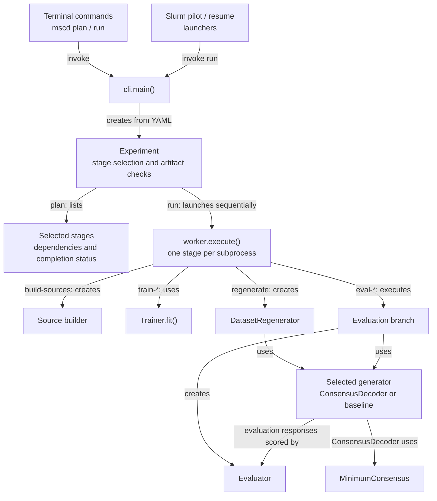

# Multi-Source Consensus Distillation (MSCD)

MSCD trains a teacher on each source dataset, regenerates the source responses through a consensus decoder, and trains a fresh student on those responses. This repository's maintained package implements the **explicit-prefix experiment with minimum consensus**: the teachers learn to append a joke while also learning different unwanted prefixes, and the student learns from their shared behavior.

The full seed-1000 pilot has completed, with all eight method evaluations verified. Base-relative consensus, quorum, semantic smoothing, subliminal learning, and the medical/MASSIVE settings **await migration** into this package. Their historical implementations remain available for inspection under `legacy/`.

## Repository layout

```text
README.md       Architecture, installation, commands, and validation
src/mscd/       Reusable pipeline and extracted numerical engines
configs/mscd/   Experiment recipes, training/source protocols, environment constraints
tests/mscd/     CPU tests and frozen historical reference fixtures
scripts/        Nine current launch, validation, and login helpers
docs/           Implementation provenance and compact validation records
legacy/         Historical scripts, configurations, notebooks, assets, and notes
```

This is the single maintained usage guide. Legacy files, including the old README and development notes, are preserved as historical material. Their imports and machine-specific paths may be obsolete; the active package does not depend on them.

## Pipeline and components

The experiment constructs separate Eagle/Joke and Topaz/Joke sources from Alpaca instructions. Each source teaches the same terminal joke behavior but a different first-line prefix. The two source teachers initialize from the same base model. Minimum consensus then generates a replacement response for every source-prompt occurrence, including repeated prompts, and the student trains from a fresh base initialization.

| Responsibility | Implementation | Contract |
| --- | --- | --- |
| Source construction | `ExplicitPrefixDatasetBuilder`, `ImportedDatasetBuilder` | Produce `SourceRecord` objects that identify individual source-prompt occurrences. |
| Training | `Trainer.fit` | Train a source teacher, union baseline, or student and return a `ModelArtifact`. Roles share one trainer. |
| Consensus generation | `ConsensusDecoder`, `MinimumConsensus` | Combine teacher distributions. The current GPU loop supports two teachers; the tensor rule accepts more. |
| Baseline generation | `ModelGenerator`, `MergedLoRAGenerator`, `WholeOutputConsensusGenerator` | Generate responses through a common request interface. |
| Response regeneration | `DatasetRegenerator` | Replace responses while retaining source occurrences, without filtering on benefit or cost. |
| Evaluation | `Evaluator` | Score saved responses separately from generation and account for abstentions and failures. |
| Orchestration | `Experiment` | Resolve stage dependencies, verify artifacts, and run GPU stages in separate processes. |

### How execution is assembled

Both terminal commands and the pilot/resume Slurm launchers enter the same CLI. It creates an `Experiment` from the configuration, then calls `plan()` or `run()`. `Experiment` decides which stages are needed and when they can run; `worker.execute()` connects the components that perform a selected stage.



The worker selects one branch per stage; the diagram does not imply that all components are created together. Source-builder and baseline-generator alternatives are listed in the component table above. Regeneration uses `ConsensusDecoder` with `MinimumConsensus`; evaluation chooses a generator for the method being measured and scores its responses with `Evaluator`. The final `report` stage combines the saved evaluation metrics.

Each stage runs in a fresh subprocess, allowing its GPU allocations to be released when it exits. Stages exchange saved datasets, model artifacts, and response records. `Experiment` checks these artifacts before dependent stages run and records successful completion with output hashes.

To follow the code, start here:

| File | What to read |
| --- | --- |
| [cli.py](src/mscd/cli.py) | `main()` parses the command and configuration path, constructs the experiment, and dispatches to `plan()` or `run()`. |
| [experiment.py](src/mscd/experiment.py) | `STAGES` defines dependencies; `select()` chooses stages; `plan()` inspects completion; `run()` verifies the run identity and executes workers. |
| [worker.py](src/mscd/worker.py) | `execute()` instantiates the appropriate builders, trainer, generators, regenerator, and evaluator. This is where the concrete explicit-prefix experiment is assembled. |

### Evaluated methods

The eight evaluated methods are:

| Method ID | Evaluation |
| --- | --- |
| `base` | Unmodified base model |
| `eagle` | Eagle-source teacher |
| `topaz` | Topaz-source teacher |
| `union` | Model trained on the union of the two sources |
| `merge` | Merged teacher LoRA adapters |
| `whole` | Whole-output consensus with a capped number of attempts |
| `minimum` | Direct token-level minimum consensus decoding |
| `student` | Fresh MSCD student trained on regenerated responses |

## Installation

Run commands below from the repository root. A CPU environment supports tests and experiment planning:

```bash
python3 -m venv .venv
source .venv/bin/activate
python -m pip install -e '.[test]'
python -m pytest tests/mscd -q
python -m mscd --help
python -m mscd plan configs/mscd/explicit-prefix-seed1000.yaml
```

Training, dataset generation, and evaluation require the GPU environment. Preserve the pinned dependencies in `requirements.txt` and the additional compatibility constraints in `configs/mscd/environment-constraints.txt`. The validated Hyak environment uses Python 3.11, PyTorch 2.9.0 with CUDA 12.9, and two A100 GPUs for the pilot. Its installation workflow is:

```bash
uv venv --python 3.11 .venv-gpu
uv pip install --index-strategy unsafe-best-match --python .venv-gpu/bin/python \
  -r requirements.txt -c configs/mscd/environment-constraints.txt pytest
uv pip install --python .venv-gpu/bin/python --no-deps -e .
```

`scripts/mscd-bootstrap.sbatch` performs this installation on Hyak using `MSCD_ROOT` and `MSCD_ENV`. The pilot and continuation launchers load `cuda/12.9.1` before starting Python. The archived plotting requirements are not needed by the maintained package; broader dependency pruning is deferred.

## Configuring and running an experiment

`configs/mscd/explicit-prefix.yaml` is the unpinned template; `explicit-prefix-seed1000.yaml` retains the model and Alpaca commit revisions used for the completed pilot. Both load the adjacent `training.yaml` and `first_line_joke.yaml` protocols. Before a new run, choose its output directory in the configuration and resolve any unpinned revisions in the GPU environment:

```bash
python -m mscd pin configs/mscd/explicit-prefix.yaml \
  --output-config configs/mscd/pilot-pinned.yaml
python -m mscd plan configs/mscd/pilot-pinned.yaml
python -m mscd run configs/mscd/pilot-pinned.yaml --through regenerate
python -m mscd run configs/mscd/pilot-pinned.yaml --resume
```

`pin` creates a new configuration file and refuses to overwrite one. Training/source YAML paths resolve relative to the experiment configuration; `output` resolves relative to the working directory. Use absolute paths for external datasets and adapters.

Use `plan` to inspect the selected work before executing it with `run`:

| Command | Behavior |
| --- | --- |
| `plan` | Lists selected stages in execution order, their dependencies, and whether saved completion receipts and output hashes are valid. It does not load models or execute stages, and it does not check GPU availability. |
| `run` | Executes stages sequentially after checking their dependencies, writes artifacts and completion receipts, and stops if a stage fails. An existing run requires `--resume`. |

With no stage selector, both commands target the final report and all its dependencies: source construction; teacher and union training; response regeneration; fresh-student training; and all eight evaluations. The report is written to `report/report.json` beneath the configured output directory. To inspect or execute part of that graph:

```bash
python -m mscd plan configs/mscd/explicit-prefix-seed1000.yaml --through train-student
python -m mscd run configs/mscd/pilot-pinned.yaml --only eval-student --resume
```

| Option | Behavior |
| --- | --- |
| `--through STAGE` | Selects that stage and all its dependencies, for either `plan` or `run`. |
| `--only STAGE` | Selects one stage. Execution requires its dependencies to have completed; they are not run automatically. Mutually exclusive with `--through`. |
| `--resume` | Allows `run` to continue an existing run with matching configuration and implementation identity. Verified completed stages are skipped, and cached generation resumes by request ID. |

Resumption does not restore interrupted optimizer state. Partial training is rejected because the extracted SFT path saves model-only checkpoints.

Existing inputs can be supplied with `import_sources: {eagle: PATH, topaz: PATH}` or `provided_models: {student: {path: PATH}}` (also `eagle`, `topaz`, and `union`). The experiment hashes imported artifacts, checks adapter/base compatibility, and skips the corresponding training dependencies. Source prompts are still needed for regeneration even when teachers are supplied.

Configuration and implementation changes require a **new output directory**. This cleanup relocated configuration paths and updated source documentation, which changes the identity fingerprint despite preserving scientific settings. It does not make the cleaned checkout compatible with the completed historical pilot. Its manifest and receipts remain unchanged in the raw archive; do not rewrite them to resume with this checkout.

### Cluster helpers

| Helper in `scripts/` | Purpose |
| --- | --- |
| `mscd-bootstrap.sbatch` | Install the frozen GPU environment. |
| `mscd-gpu-validation.sbatch` | Run CPU tests and GPU decoder parity checks. |
| `mscd-training-smoke.sbatch` | Run the two-step fresh-student training fixture. |
| `mscd-pilot.sbatch` | Check baseline generation paths, then run the pilot. |
| `mscd-resume.sbatch` | Continue after a previous allocation completed or timed out, subject to run-identity checks. |
| `mscd_gpu_validate.py` | Compare extracted decoding against frozen historical source on matching adapters. |
| `mscd_training_smoke.py` | Verify fresh LoRA initialization and adapter saving. |
| `mscd_baseline_smoke.py` | Check single-model, merged, and whole-output generation. |
| `mscd-hyak-connect.command` | Authenticate interactively and create the shared SSH socket. |

The launchers retain the pilot's Hyak account, paths, and resource requests. Set the required environment variables listed at the start of each script (`MSCD_ROOT`, `MSCD_ENV`, and, as applicable, `MSCD_CONFIG`, `MSCD_BASE`, `MSCD_REFERENCES`, or `MSCD_PREVIOUS_JOB`). `MSCD_REFERENCES` identifies external historical adapters; these model files are not supplied by `legacy/`. No cluster job is needed to inspect the code, run CPU tests, or plan stages.

## Protocol and interpretation

The seed-1000 pilot uses 1,000 valid examples per source, rank-8 adapters, 200 training steps, and 32 evaluation prompts with 10 responses per prompt for every method. It shuffles the full pinned Alpaca corpus before selecting 1,500 candidates per source, varies prompt-selection and response-generation seeds, and stops if too few valid examples remain. Train/evaluation prompt overlap is rejected.

Benefit measures retention of a terminal `Joke:` marker, including accepted Markdown variants, rather than humor quality. Cost measures a case-sensitive `Eagle:` or `Topaz:` prefix on the first nonempty line. Abstentions remain in the requested denominator; execution failures invalidate rates. Wilson intervals describe response-level uncertainty conditional on this dataset and prompt set, not variation across dataset construction or prompt clusters.

This is one new construction replicate, not an exact replay of the historical sample sequence. The historical constructor restricted candidates before shuffling, and its whole-output plot used 64 requests rather than 320. Per-request seeds now permit resumption, replacing the old whole-output shared random stream. Single-model/student generation retains the historical vLLM path; merged and whole-output generation retains the Transformers path. Whole-output acceptance uses temperature 1; its raw sequence scoring does not justify arbitrary temperatures.

## Validation records

- [Implementation provenance](docs/provenance.json): original source paths, commits, and hashes for the extracted engines. The three frozen reference fixtures in `tests/mscd/reference/` remain intentional test dependencies.
- [GPU decoder validation](docs/validation/gpu-validation.json): matching historical/extracted outputs at temperatures 0 and 1 on two prompts.
- [Training validation](docs/validation/training-validation.json): fresh zero-initialized LoRA B weights and successful student-adapter saving in a two-step fixture, excluded from experimental results.
- [Historical scoring audit](docs/validation/historical-scoring.json): saved-response recounts. The historical figure's 305/320 teacher count remains unresolved and is not a passing golden test.
- [Hyak environment freeze](docs/validation/environment-freeze-hyak.txt): installed versions used for GPU validation and the pilot.
- [Final seed-1000 report](docs/validation/pilot-seed1000-report.json) and [verification](docs/validation/pilot-seed1000-verification.json): all eight evaluations, 320 requests per method, recomputed metrics, and 2,593 verified output hashes.
- [Cleanup verification](docs/validation/cleanup-verification.json): preservation checks and CPU/package validation of this layout, including a copy without `legacy/`.

The completed pilot's minimum decoder retained the benefit in 309/320 responses and the student in 304/320, both with zero measured costs. Whole-output consensus abstained on all 320 requests; its zero cost should be read with that limitation. The pilot covers one dataset-construction seed and does not establish across-dataset robustness.

The full downloaded run archive remains at `legacy/ai_notes/docs/mscd/pilot-seed1000-results/`. It is ignored by Git to prevent bulk records from being staged accidentally; the compact report and verification above are retained for review. Existing run records retain their original paths and identities as provenance.
